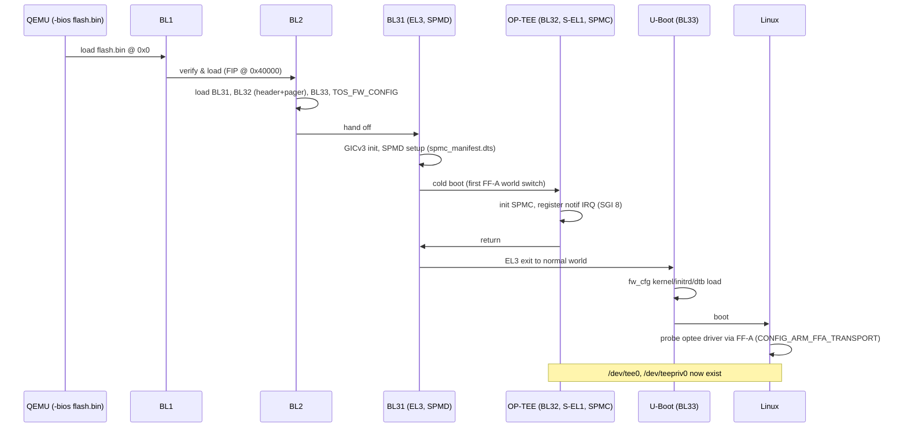
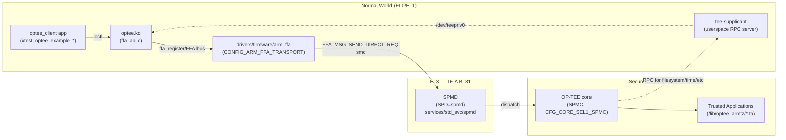
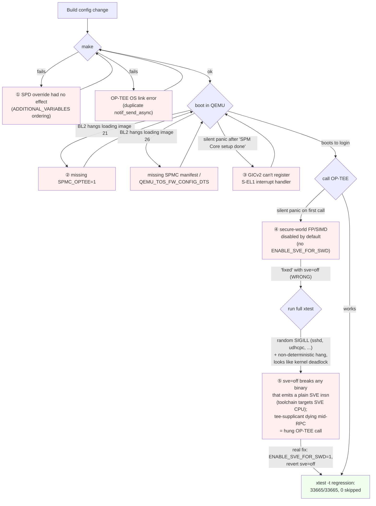

# Handoff: `qemu_aarch64_virt` — TF-A + OP-TEE (FF-A) secure-boot support

**Board:** `board/qemu/aarch64-virt`
**Defconfig:** `configs/qemu_aarch64_virt_defconfig`
**Branch:** `2025.08-az`
**Status:** done, verified — full `xtest -t regression` suite passes (33665/33665 subtests, 0 skipped)

This replaces the earlier design note
([`2026-09-25-qemu-aarch64-virt-tfa-optee-ffa-design.md`](2026-09-25-qemu-aarch64-virt-tfa-optee-ffa-design.md))
as the entry point — that file is the blow-by-blow debug log (useful for
"why is it written this way", kept for the record); this one is the
"what is it and how do I use it" summary.

## 1. What this is

Before this work, `qemu_aarch64_virt_defconfig` booted U-Boot directly as
the QEMU `-bios`, with no secure world at all (`optee-client` was present
in the rootfs but had nothing to talk to). This adds a real secure-boot
chain and turns on OP-TEE's **FF-A** transport (Arm's Firmware Framework
for A-profile — the modern replacement for the legacy OP-TEE SMC ABI),
with OP-TEE running as the **FF-A SPMC at S-EL1** (not S-EL2/Hafnium —
simplest viable setup for QEMU).

## 2. Architecture

### 2.1 Boot chain



`flash.bin` = `bl1.bin` followed by `fip.bin` at offset `0x40000`
(assembled by `board/qemu/aarch64-virt/post-image.sh`; TF-A's `qemu`
platform does not produce this file on its own — only the EBBR board's
`fvp`/SystemReady platforms' build rules do that automatically).

### 2.2 FF-A call path (steady state, after boot)



Both worlds share the physical CPU; FF-A direct messages are
synchronous SMC round-trips. Asynchronous notifications (used e.g. for
cancellation) go over GIC SGI 8 (`CFG_CORE_ASYNC_NOTIF_GIC_INTID`,
requires GICv3 — see §4).

## 3. Files changed

| File | What |
|---|---|
| `configs/qemu_aarch64_virt_defconfig` | TF-A, OP-TEE OS, kernel/toolchain options, optee-test/examples, rootfs size |
| `board/qemu/aarch64-virt/linux.config` | `CONFIG_TEE`, `CONFIG_OPTEE`, `CONFIG_ARM_FFA_TRANSPORT` |
| `board/qemu/aarch64-virt/spmc_manifest.dts` | **new** — FF-A manifest describing OP-TEE-as-SPMC to TF-A's SPMD (`TOS_FW_CONFIG`) |
| `board/qemu/aarch64-virt/post-image.sh` | **new** — assembles `flash.bin` (bl1.bin + fip.bin @ 0x40000) |
| `board/qemu/aarch64-virt/readme.txt` | updated QEMU invocation + "Boot Details" explaining every non-obvious flag |
| `boot/arm-trusted-firmware/arm-trusted-firmware.mk` | generic buildroot infra fix — `ADDITIONAL_VARIABLES` now applied *last*, so boards can override package defaults (e.g. `SPD=opteed` → `SPD=spmd`) |

## 4. Config reference — every non-obvious flag and why

### TF-A (`BR2_TARGET_ARM_TRUSTED_FIRMWARE_ADDITIONAL_VARIABLES`)

| Flag | Why |
|---|---|
| `SPD=spmd` | Use the FF-A dispatcher instead of the legacy `opteed` SMC dispatcher |
| `SPMD_SPM_AT_SEL2=0` | SPMC lives at S-EL1 (OP-TEE), not S-EL2 (Hafnium) |
| `SPMC_OPTEE=1` | **Without this, BL2 silently skips loading the OP-TEE pager/paged images** — `SPD=spmd` alone doesn't wire up OP-TEE-specific image handling in TF-A's `qemu` platform code |
| `QEMU_USE_GIC_DRIVER=QEMU_GICV3` | TF-A's `qemu` platform defaults to GICv2, which can't register the S-EL1 secure-interrupt handler FF-A/SPMD needs — fails and panics silently otherwise |
| `ENABLE_SVE_FOR_SWD=1` | **The big one** — see §5.4. Without it, any OP-TEE call traps to EL3 and panics, because TF-A disables secure-world FP/SIMD by default whenever `ENABLE_SVE_FOR_NS` is on (the `qemu` platform's default) |
| `LOG_LEVEL=40`, `ENABLE_ASSERTIONS=1` | Debug aids added while chasing the *silent* panics below — release builds default to neither, so panics print nothing. Cheap to keep on |
| `QEMU_TOS_FW_CONFIG_DTS=$(TOPDIR)/board/qemu/aarch64-virt/spmc_manifest.dts` | The FF-A SPMC manifest (§2.1); without it BL2 hangs trying to load a `TOS_FW_CONFIG` image that was never built |

### OP-TEE OS (`BR2_TARGET_OPTEE_OS_ADDITIONAL_VARIABLES`)

| Flag | Why |
|---|---|
| `CFG_CORE_FFA=y` | Enable FF-A ABI support in optee_os core |
| `CFG_CORE_SEL1_SPMC=y` | **Without this**, `CFG_CORE_ASYNC_NOTIF` defaults on but the SPMC-specific notification implementation doesn't get excluded — both the generic and SPMC `notif_send_async()` get compiled in → link error (multiple definition) |
| `CFG_ARM_GICV3=y` | Must match the GICv3 driver selected in TF-A, or optee_os's own GIC driver polls registers that don't exist under GICv3-only hardware and hangs |

### QEMU command line

| Flag | Why |
|---|---|
| `-M virt,secure=on` | Turns on the secure world at all |
| `gic-version=3` | Matches `QEMU_USE_GIC_DRIVER=QEMU_GICV3` / `CFG_ARM_GICV3=y` above |
| `-bios output/images/flash.bin` | TF-A boot chain instead of raw U-Boot |
| `-cpu cortex-a710` (**no** `sve=off`) | See §5.4 — disabling SVE on the CPU while the toolchain targets a CPU that architecturally has SVE breaks arbitrary binaries |

### Kernel (`board/qemu/aarch64-virt/linux.config`)

| Flag | Why |
|---|---|
| `CONFIG_TEE=y`, `CONFIG_OPTEE=y` | The OP-TEE Linux driver |
| `CONFIG_ARM_FFA_TRANSPORT=y` | **Without this**, `drivers/tee/optee/ffa_abi.c`'s `ffa_register()` call is compiled out behind `IS_REACHABLE(...)` — no error, just no `/dev/tee0` |

### Toolchain / rootfs (`configs/qemu_aarch64_virt_defconfig`)

| Flag | Why |
|---|---|
| `BR2_TOOLCHAIN_BUILDROOT_CXX=y` | xtest needs C++. Note: `BR2_INSTALL_LIBSTDCPP` has no Kconfig prompt — it's `select`-only; setting it directly in a defconfig is silently dropped by `olddefconfig`. This is the actual toggle |
| `BR2_PACKAGE_OPTEE_TEST=y`, `BR2_PACKAGE_OPTEE_EXAMPLES=y` | `xtest` + `optee_example_*` test/demo binaries |
| `BR2_TARGET_ROOTFS_EXT2_SIZE="450M"` | Grown twice (128M→350M→450M) for TF-A/OP-TEE images and then the test suite |

## 5. Debugging journey

Everything below was found by **attaching gdb to QEMU's `-s` gdbserver on
a hang**, resolving the frozen PC against the relevant `.elf`
(`addr2line`), and reading the corresponding source — not by guessing.
Three of the five issues were *silent* panics/hangs with zero console
output, which is why this was necessary.



### 5.1 `SPD=spmd` had no effect (build-infra fix)

`boot/arm-trusted-firmware/arm-trusted-firmware.mk` appended
`ADDITIONAL_VARIABLES` to `MAKE_OPTS` *before* the package's own
`SPD=opteed` default. On a `make` command line, the **last** assignment
of a variable wins — so the board's override was always overridden right
back. Fixed by moving the `ADDITIONAL_VARIABLES` expansion to the very
end of `ARM_TRUSTED_FIRMWARE_MAKE_OPTS`. Generic infra fix, not specific
to this board — benefits anyone overriding `SPD`/other TF-A opts.

### 5.2 OP-TEE OS link error: duplicate `notif_send_async`

`CFG_CORE_FFA=y` alone selects the async-notification code path
(`thread_spmc.c`'s own `notif_send_async()`), but the *generic* default
implementation (`notif_default.c`) only gets excluded from the build when
`CFG_CORE_SEL1_SPMC=y` is **also** set — found in optee_os's
`mk/config.mk`. Without it, both get compiled and linked → duplicate
symbol.

### 5.3 BL2 hangs loading images 21 / 26

Two separate causes, same symptom (BL2 log just stops):

- **Image 21 (`BL32_EXTRA1`, the OP-TEE pager)**: TF-A's `qemu` platform
  marks this image `IMAGE_ATTRIB_SKIP_LOADING` and only clears that flag
  when `SPMC_OPTEE` is `#define`d — which needs the separate build
  variable `SPMC_OPTEE=1`, not implied by `SPD=spmd`.
- **Image 26 (`TOS_FW_CONFIG`)**: this is the FF-A SPMC manifest TF-A
  hands to the SPMC. Needs an actual DTS (`spmc_manifest.dts`, taken from
  OP-TEE's own `build` repo, `qemu_v8/spmc_el1_manifest_virt.dts` —
  targets the exact same TF-A `qemu` plat + `vexpress-qemu_armv8a`
  combination used here) wired via `QEMU_TOS_FW_CONFIG_DTS`.

### 5.4 The SVE saga (the one worth reading carefully)

This is two bugs that look identical from the outside and were debugged
in the wrong order.

**Real bug:** TF-A's `qemu` platform defaults `ENABLE_SVE_FOR_NS=2`
(SVE available to normal world). Per TF-A's own docs
(`docs/getting_started/build-options.rst`), turning that on **disables
secure-world FP/SIMD access by default** — specifically so the secure
world can't corrupt live SVE Z-register state belonging to the normal
world (Z-regs alias the FP/SIMD V-regs). OP-TEE itself uses FP/SIMD
internally (`CFG_TA_FLOAT_SUPPORT=y` TAs, optee_os's own crypto/memcpy),
so **any call into OP-TEE trapped straight to EL3 and panicked** —
silently, because `ENABLE_ASSERTIONS=0` by default in release builds.

**Wrong fix (tried first):** `-cpu cortex-a710,sve=off` on the QEMU
command line. This "worked" for the first few manual tests
(`hello_world`, `aes`, `random`, a handful of `xtest` cases) because the
trap only fires once SVE-capable code actually executes — and those
particular code paths happened not to hit it. But `BR2_cortex_a710`
tunes GCC for a CPU that architecturally has SVE, so **any package build
— including glibc itself — may contain plain SVE instructions in
ordinary, non-crypto code**, regardless of what the QEMU CPU model
actually supports. Confirmed by pulling a core dump straight out of the
*running* rootfs image with `debugfs -R "dump /root/core ..."
rootfs.ext2` (no need to stop QEMU) and pointing host gdb at it against
`output/build/openssh-*/sshd`: it crashed with `SIGILL` in
`initialize_server_options()`, on a `mov z31.h, #0` — an SVE instruction
from GCC's `-fzero-call-used-regs` register-clearing security hardening,
inside an ordinary struct-init function with no SIMD algorithm in sight.

When the binary that dies this way happens to be **tee-supplicant**,
whatever OP-TEE call was waiting on an RPC to it hangs forever
(uninterruptible) — which looks, from the outside, exactly like a kernel
deadlock (all 4 vCPUs idling in `cpu_do_idle`, RCU-stall warnings), but
it's tee-supplicant that died, not the kernel. This is what made a full
`xtest -t regression` run hang non-deterministically (confirmed: it
happened at `regression_1006` for one run and `regression_1033.2` —an
unrelated supplicant-plugin test — for another), while small hand-picked
subsets of tests kept passing.

**Actual fix:** `ENABLE_SVE_FOR_SWD=1` in TF-A's `ADDITIONAL_VARIABLES`
(its only precondition is `ENABLE_SVE_FOR_NS != 0`, already true) —
grants the secure world FP/SIMD access instead of taking SVE away from
the normal world. Revert `sve=off`.

**Verification:** no more `Illegal instruction` anywhere in boot (sshd,
the network init script, and crond's helper were all silently dying on
this before); full `xtest -t regression`:

```
33665 subtests of which 0 failed
111 test cases of which 0 failed
0 test cases were skipped
```

(Earlier partial runs had **108–110 test cases skipped** —
`CFG_TA_FLOAT_SUPPORT`-gated tests silently no-op'd when FP wasn't
actually available, another symptom of the same root cause, easy to miss
if you don't check the skip count.)

## 6. How to build and run

```bash
# optional: proxy, if package downloads stall (see ~/.zshrc aliases
# `proxy` / `proxy1` on this host)
export http_proxy=http://10.9.0.31:8838 https_proxy=http://10.9.0.31:8838

make qemu_aarch64_virt_defconfig
make

# boot (also written to output/images/start-qemu.sh by the build):
qemu-system-aarch64 -M virt,secure=on,gic-version=3 -cpu cortex-a710 \
  -m 2048 -nographic -smp 4 \
  -bios output/images/flash.bin -kernel output/images/Image \
  -append "rootwait root=/dev/vda console=ttyAMA0" \
  -netdev user,id=eth0 -device virtio-net-device,netdev=eth0 \
  -nic user,model=e1000,hostfwd=tcp::2222-:22 \
  -drive file=output/images/rootfs.ext4,if=none,format=raw,id=hd0 \
  -device virtio-blk-device,drive=hd0
```

Login: `root`, no password.

**Gotcha:** changing an OP-TEE OS config option (`BR2_TARGET_OPTEE_OS_*`)
does *not* automatically retrigger a TF-A rebuild, even though TF-A
embeds OP-TEE's `tee.bin` into its FIP. Buildroot's per-package stamp
files don't do fine-grained "rebuild if a dependency's *content*
changed" the way a real Makefile dependency graph would. Run
`make arm-trusted-firmware-dirclean` after any such change, or `fip.bin`
silently keeps the stale `tee.bin`.

## 7. Verification checklist

| Check | Command | Expected |
|---|---|---|
| TF-A/OP-TEE boot | (boot log) | reaches `buildroot login:` |
| OP-TEE driver via FF-A | `dmesg \| grep optee` | `optee: revision 4.6`, `optee: initialized driver` |
| Device nodes | `ls /dev/tee*` | `/dev/tee0`, `/dev/teepriv0` |
| Supplicant | (boot log) | `Starting tee-supplicant: ... OK` |
| Basic call | `optee_example_hello_world` | `TA incremented value to 43` |
| Full regression | `xtest -t regression` | `0 failed`, `0 ... skipped` |
| No codegen/SVE regressions | (boot log) | no `Illegal instruction` anywhere |

## 8. Known limitations / not investigated

- `sshd` still fails to start by default (`Privilege separation user
  sshd does not exist`) — unrelated to any of the above, just a missing
  user account in this minimal rootfs. Cosmetic.
- No attempt made to move the SPMC to S-EL2 (Hafnium) or to add
  additional FF-A secure partitions beyond OP-TEE itself — out of scope,
  not needed for what was asked.
- `ENABLE_ASSERTIONS=1` and `LOG_LEVEL=40` are left on in the committed
  config. They were debug aids, but they're cheap and they're also the
  only reason any of the panics in §5 produced *any* diagnostic output —
  recommend keeping them unless there's a concrete size/perf reason not
  to.

## 9. References

- Design/debug log (chronological, more detail per issue):
  [`2026-09-25-qemu-aarch64-virt-tfa-optee-ffa-design.md`](2026-09-25-qemu-aarch64-virt-tfa-optee-ffa-design.md)
- Commits (`2025.08-az`, oldest first):
  `64f13888ea` (build green) → `a5d53554d1` (boots to login) →
  `8e67ab09a3` (kernel FF-A driver) → `70ca5e8a9b` (xtest added, SVE bug
  found) → `37b793f811` (SVE bug fixed properly)
- TF-A build options doc (source of the `ENABLE_SVE_FOR_SWD` fix):
  `output/build/arm-trusted-firmware-*/docs/getting_started/build-options.rst`
- OP-TEE's own FF-A manifest for this exact platform combo:
  `https://github.com/OP-TEE/build` → `qemu_v8/spmc_el1_manifest_virt.dts`
